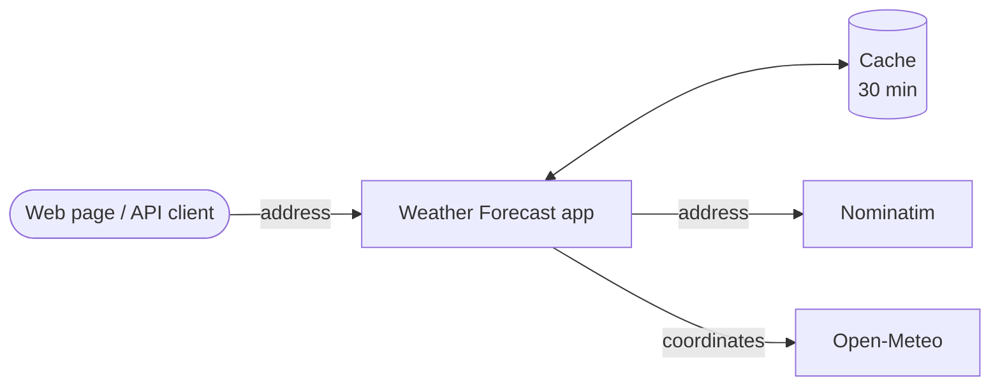

# Weather Forecast

A Ruby on Rails app that takes a US address and shows its current temperature and a daily forecast (highs and lows). Results are cached for 30 minutes, and the app shows when a result came from the cache.

It works as a web page and as a JSON API, and needs **no API keys or environment variables**: clone it, run `bin/setup`, and use it.

## Features

- Search a US address, pick it from a list of matches, and see the forecast for its zip code
- Choose the units (°C or °F) and the number of days (1–16)
- Use the full web UI or only the JSON API
- Addresses and forecasts cached for 30 minutes
- Interactive API documentation (Swagger UI) at `/api-docs`

## Tech stack

| Area | Technology |
|---|---|
| Language and framework | Ruby 4.0.7, Rails 8.1.4 |
| Cache | [Solid Cache](https://github.com/rails/solid_cache) |
| Frontend | [Turbo](https://turbo.hotwired.dev) (Hotwire) and [Tailwind CSS](https://tailwindcss.com) |
| Address lookup | [Nominatim](https://nominatim.org/release-docs/latest/api/Search/) (OpenStreetMap), through the [geocoder](https://github.com/alexreisner/geocoder) gem |
| Weather data | [Open-Meteo Forecast API](https://open-meteo.com/en/docs)|
| Tests | [RSpec](https://github.com/rspec/rspec-rails), [WebMock](https://github.com/bblimke/webmock), [FactoryBot](https://github.com/thoughtbot/factory_bot_rails) |
| API docs | [rswag](https://github.com/rswag/rswag) (OpenAPI 3 + Swagger UI) |
| Code quality | [RuboCop](https://github.com/rails/rubocop-rails-omakase) |

## Getting started

```sh
git clone https://github.com/nascimentoleo/rails-weather-forecast.git
cd rails-weather-forecast
```

### With Docker (recommended)

Requires [Docker](https://docs.docker.com/get-started/get-docker/).

```sh
docker compose up      # builds the image and starts the server
```

### Without Docker

Requires Ruby 4.0.7. Install it with a Ruby version manager, such as [rbenv](https://github.com/rbenv/rbenv) or [asdf](https://asdf-vm.com):

```sh
# with rbenv (it picks up the project's .ruby-version file)
rbenv install 4.0.7

# or with asdf
asdf plugin add ruby
asdf install ruby 4.0.7
asdf set ruby 4.0.7
```

Then install the gems and start the server:

```sh
bin/setup
```

To start the server again later, run `bin/dev`.

With either option, open `http://localhost:3000` in your browser.

## Usage

### Web page

1. Type an address and press **Enter**: a list of matching addresses appears.
2. Pick one to see its current temperature and daily forecast.
3. Change the units or days and click **Search** to reload the forecast.

### API only

The API can be used on its own, as a backend:

| Endpoint | What it does |
|---|---|
| `GET /api/v1/addresses?full_address=…` | Lists the US addresses that match the text |
| `GET /api/v1/forecast?full_address=…&units=…&days=…` | Returns the daily forecast for the address provided |

```sh
curl "http://localhost:3000/api/v1/forecast?full_address=1180%20Seven%20Seas%20Dr,%20Lake%20Buena%20Vista&units=fahrenheit&days=3"
```

For parameters, responses and error codes, see the API documentation: open `http://localhost:3000/api-docs` or read [`swagger/v1/swagger.yaml`](swagger/v1/swagger.yaml).

## How it works



1. **Address lookup.** The address is searched on Nominatim, which returns the matching US addresses with their zip codes and coordinates. Addresses without a zip code are dropped.
2. **Weather lookup.** The forecast for that zip code is fetched from Open-Meteo, using the address's coordinates and the chosen units and days.
3. **Response.** The result is shown on the web page or returned as JSON, with a flag telling whether the address and the forecast came from the cache.

Each step is cached for 30 minutes, so repeated searches don't call the external services again. The cache settings live in `config.cache_options` (`config/application.rb`).

## Tests and checks

`bin/ci` runs everything below except the Swagger regeneration (plus `bin/setup` and an importmap audit). Each check can also be run on its own:

```sh
bin/ci                      # all checks in one go
bundle exec rspec           # test suite (with Docker: docker compose exec web bundle exec rspec)
bin/rubocop                 # code style
bin/brakeman                # security analysis
bin/bundler-audit           # known vulnerabilities in gems
RAILS_ENV=test bin/rails rswag:specs:swaggerize   # regenerate swagger/v1/swagger.yaml
```

## Trade-offs

- **Free services vs. rate limits:** Addresses come from Nominatim and weather from Open-Meteo because neither needs an account or API key, so anyone can run the project right after downloading it. The downside: they're free public services with no uptime guarantee, and Nominatim accepts only about [one request per second](https://operations.osmfoundation.org/policies/nominatim/), so when many people search different addresses at the same moment, some of them get an error asking them to try again. In a real production setup we would switch the address provider, and that's easy: it only takes a change in the geocoder configuration. Options:
  - [LocationIQ](https://locationiq.com): runs Nominatim with higher limits. Only a settings change and an API key.
  - [Self-hosted Nominatim](https://nominatim.org/release-docs/latest/admin/Installation/): no limit at all. Only a settings change, but it needs its own server.
  - [Google Maps](https://developers.google.com/maps/documentation/geocoding/overview): a settings change, an API key and small adjustments in one file.
- **Rails' built-in cache instead of Redis:** Redis is the usual tool for caching, but it's one more service to install, run and pay for. Rails' own cache (Solid Cache) keeps results in a simple file instead. The downside: it's slower than Redis, and it only works when the app runs on a single server.
- **One forecast per zip code:** Forecasts are saved by zip code, so everyone searching an address in the same zip code gets the same forecast. This means far fewer calls to the weather service, but the forecast describes the zip code area, not the exact address.
- **US addresses only:** Because forecasts are saved by zip code, mixing countries would cause mix-ups: 75001 is both a zip code in Addison, Texas and a postal code in Paris, France, so one could get the other's weather. Saving forecasts by exact location instead would avoid that, but then every address would need its own saved forecast and the cache would rarely be reused.
- **Concurrency vs. Nominatim's limit:** In production, the app runs one process per CPU core, each handling 5 requests at the same time, and they all share one cache, so repeated searches never reach the outside services twice. New address searches, however, can't go faster than Nominatim's one per second, so extra concurrency mainly helps repeated searches and forecasts.
- **Weather service limits:** Open-Meteo offers only Celsius or Fahrenheit (no Kelvin) and up to 16 days ahead. Each combination of units and days is saved separately, so the more combinations people use, the less often a saved forecast is reused.

## License

[MIT](LICENSE)
